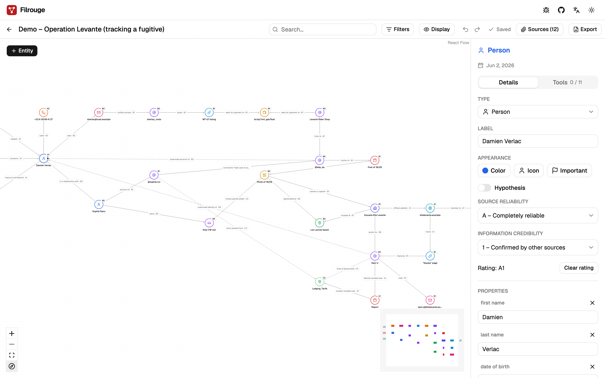
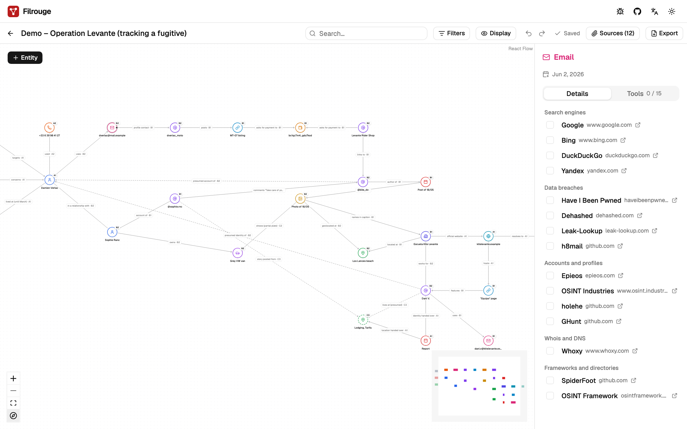
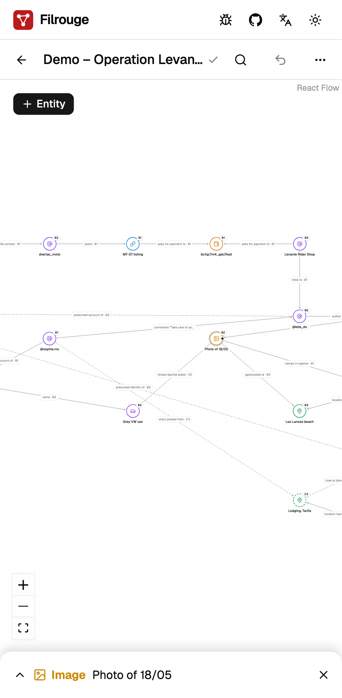
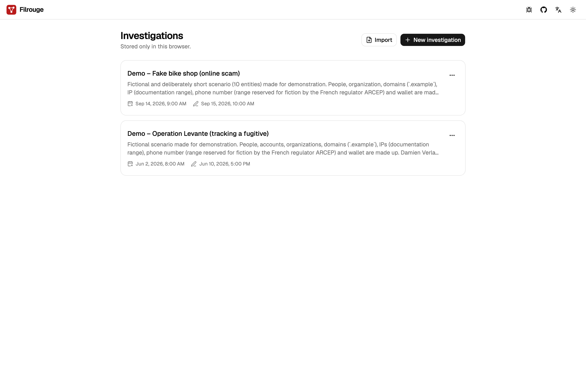

<div align="center">


# Filrouge

**Map your OSINT investigations as a graph of entities, links and sources, right in your browser.**
<br />
Local-first: no backend, no account, no tracking.

[](https://github.com/iamludal/filrouge/actions/workflows/ci.yml)
[](./LICENSE)
[](https://filrouge.iamludal.fr)

[Live demo](https://filrouge.iamludal.fr) · [Features](#-features) · [Quick start](#-quick-start) ·
[FAQ](#-faq) · [Contributing](#-contributing)

<picture>
  <source media="(prefers-color-scheme: dark)" srcset="docs/images/graph-dark.png" />
  
</picture>

</div>

## 🧭 Why Filrouge

An OSINT investigation quickly turns into scattered notes, open tabs and screenshots, and the link
between two findings lives only in your head. Graph tools exist, but most want an account, run on
someone else's servers and see every lead you type.

Filrouge keeps the whole investigation in your browser: who is linked to what, on which source,
and how much you trust it. Nothing is sent anywhere, so it is safe for sensitive work.

## ✨ Features

**Graph editing**

- 14 entity types out of the box: person, alias, email, phone, domain, IP, URL, organization,
  address, image, document, crypto wallet, vehicle, event
- Double-click to add an entity, drag from one node to another to link them, label every relation
- Custom color and icon per entity, "important" marker, display options to hide labels or ratings
- Properties, tags and Markdown notes on every entity

**Sourcing and assessment**

- Sources attached to entities and relations, with URL, capture date and archive link
- Screenshots stored locally with their SHA-256 fingerprint
- Confidence rated with the NATO Admiralty code (source reliability A–F, information credibility
  1–6), and a verified / hypothesis status (hypotheses are dashed on the graph)

**Finding your way**

- Full-text search across labels, properties and notes, highlighted on the graph
- Filters by type, tag, status, confidence and importance

**Pivot toolbox**

- For each entity, a list of relevant OSINT tools (search engines, data breaches, whois and DNS,
  accounts, archives, block explorers, company registries, reverse image search…)
- Links open in a new tab only when you click them, and you can tick each tool once checked

**Everyday comfort**

- Autosave, undo / redo (Cmd/Ctrl+Z)
- Export to PNG, SVG and a versioned JSON file you can re-import anywhere
- Light and dark themes, English and French interface
- Works on phones and tablets, with touch gestures

<details>
<summary>More screenshots</summary>
<br />

| Pivot toolbox                                                | On a phone                                                              |
| ------------------------------------------------------------ | ----------------------------------------------------------------------- |
|  |  |



</details>

What's next (automatic layouts, shortest path, timeline, encryption…): see
[ROADMAP.md](./ROADMAP.md).

## 🔒 Privacy by design

- **No backend, no account, no telemetry, no CDN.** Investigations are stored in your browser's
  IndexedDB and never leave your device.
- **A strict Content Security Policy** blocks third-party scripts, remote images (no tracking pixel
  hidden in a note) and every outgoing request (`default-src 'self'`, `connect-src 'self'`,
  `img-src 'self' data: blob:`).
- **Imported content is treated as hostile**: every file is validated against a schema, and
  Markdown is rendered without raw HTML.

Details and threat model: [SECURITY.md](./SECURITY.md).

## 🚀 Quick start

**Try it online**: open [filrouge.iamludal.fr](https://filrouge.iamludal.fr). It runs entirely in
your browser.

**Load a demo**: download one of the fictional investigations from [`examples/`](./examples), then
click **Import** on the home screen.

- [`demo-operation-levante.json`](./examples/demo-operation-levante.json): tracking a fugitive from
  a wanted notice to a kite school in Spain (25 entities).
- [`demo-fake-bike-shop.json`](./examples/demo-fake-bike-shop.json): unmasking a fake online bike
  shop (10 entities).

**Run it locally** with [Bun](https://bun.sh) ≥ 1.2 and Node.js ≥ 22:

```bash
git clone https://github.com/iamludal/filrouge.git
cd filrouge
bun install
bun run dev       # http://localhost:5173
```

## ⚖️ How does it compare?

Filrouge is a lightweight notebook for investigations, not a Maltego replacement: it does not
collect data for you.

|                                    | Filrouge             | Maltego                                       | OSINTracker                                    |
| ---------------------------------- | -------------------- | --------------------------------------------- | ---------------------------------------------- |
| Open source                        | ✅ MIT               | ❌ Proprietary                                | ❌ Proprietary                                 |
| Price                              | Free                 | Free tier, paid plans from €3,000/year        | Free                                           |
| Investigation data stays on device | ✅ Browser storage   | ❌ Transforms send entities to remote servers | ✅ Browser storage                             |
| Automated data collection          | ❌ Manual, by design | ✅ Transforms                                 | Partial: imports results exported from 2 tools |

<sub>As of October 2026, from each vendor's public website and documentation. Spotted a mistake?
Please [open an issue](https://github.com/iamludal/filrouge/issues).</sub>

## ❓ FAQ

<details>
<summary><b>Where is my data?</b></summary>
<br />

In the IndexedDB storage of the browser you use, on this device only. Nothing is synced: another
browser or another computer will not see your investigations. To back up or move an
investigation, export it to JSON and import the file elsewhere. Clearing this site's data in your
browser deletes your investigations, so export first.

</details>

<details>
<summary><b>Does it work offline?</b></summary>
<br />

Once the page is loaded, Filrouge makes no network request, so an open session keeps working
without a connection. Reloading the page offline is not supported yet: an installable app with
full offline support is planned for v1.0.

</details>

## 🤝 Contributing

Bug reports, ideas and pull requests are welcome. Read [CONTRIBUTING.md](./CONTRIBUTING.md) for the
setup, the checks and the workflow, and follow the [Code of Conduct](./CODE_OF_CONDUCT.md). Found a
vulnerability? See [SECURITY.md](./SECURITY.md).

## 📄 License

[MIT](./LICENSE) © iamludal
